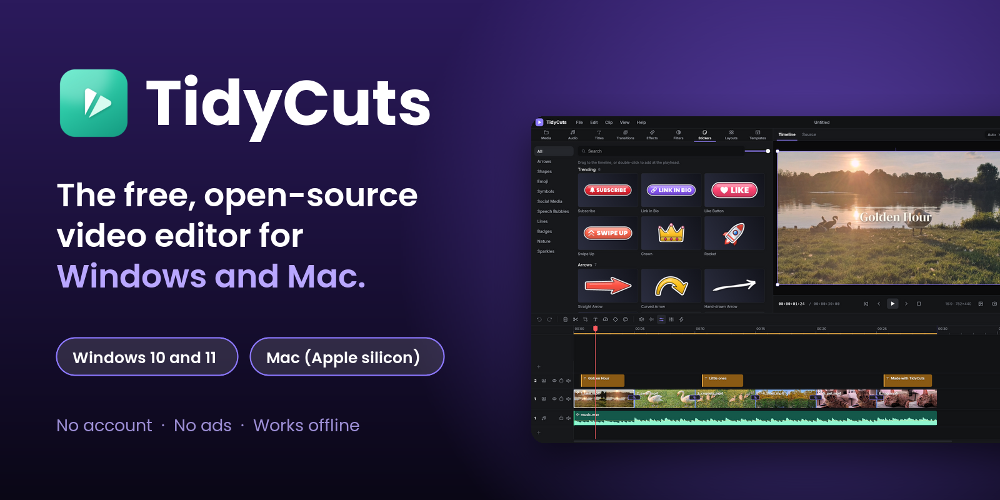
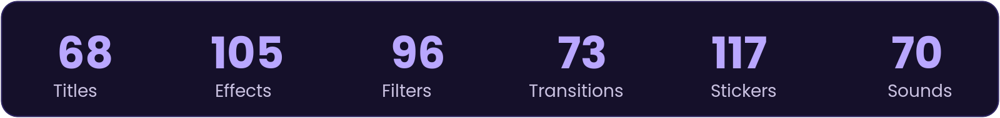
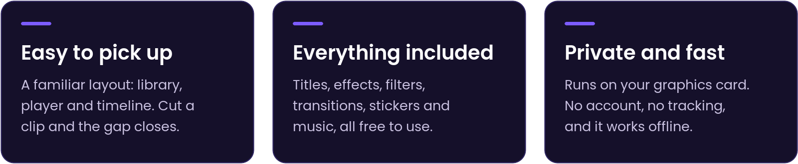
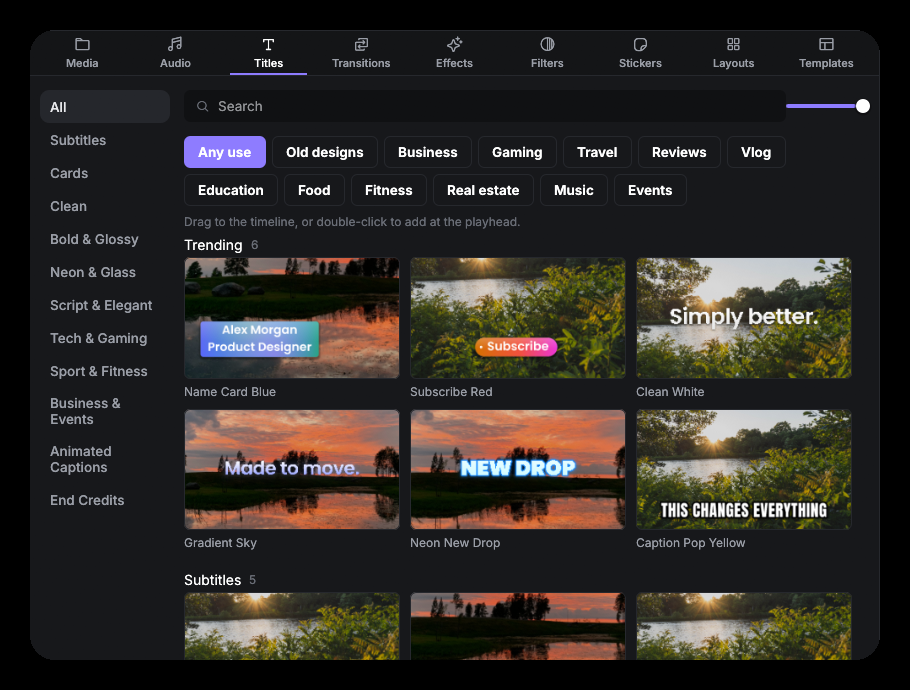
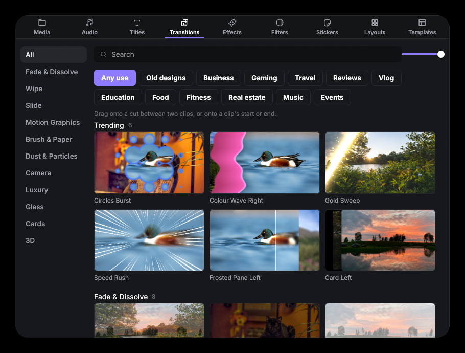
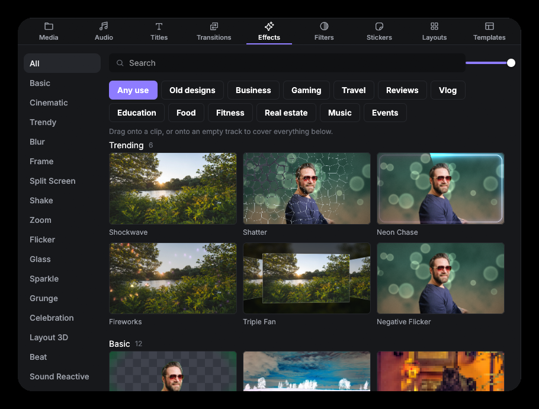
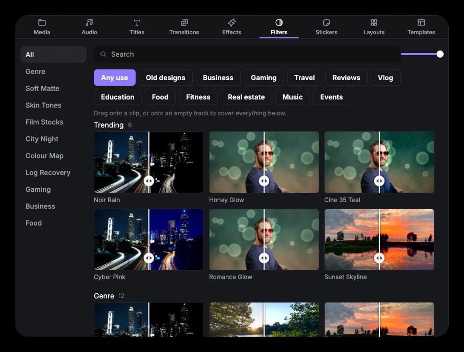
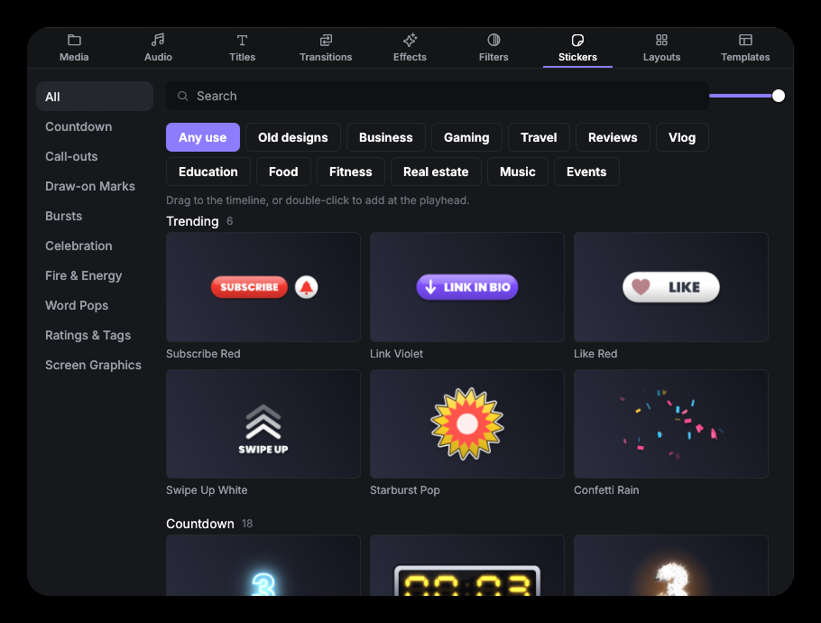
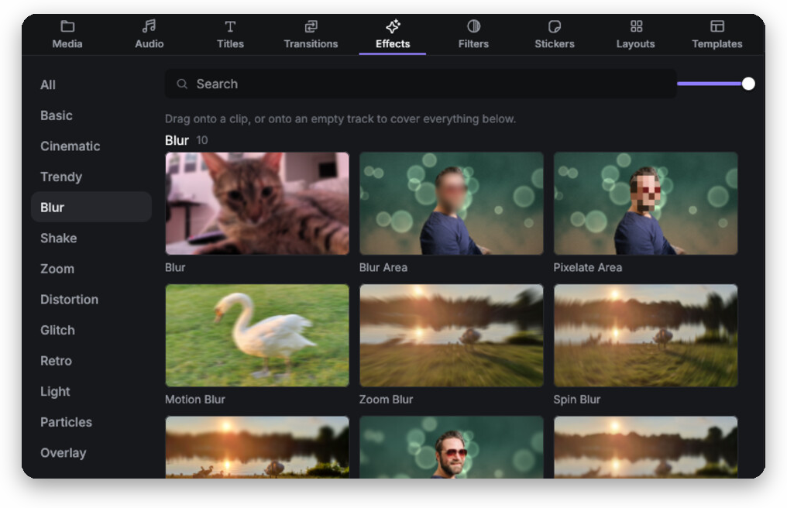

<div align="center">



<br><br>

<a href="../../releases/latest/download/TidyCuts-Setup-1.3.5.exe"></a>&nbsp;&nbsp;&nbsp;<a href="../../releases/latest/download/TidyCuts-1.3.5-macos.dmg"></a>&nbsp;&nbsp;&nbsp;<a href="../../releases/latest/download/TidyCuts-1.3.5-linux-x86_64.AppImage"></a>

<sub>Windows 10 and 11 &nbsp;·&nbsp; Mac with Apple silicon (M1 or newer) &nbsp;·&nbsp; Linux 64-bit (AppImage, .deb and .tar.gz: <a href="../../releases/latest">all Linux downloads</a>)</sub>

<sub>Version 1.3.5 · Free · No account · <a href="../../releases/latest">All downloads, including a portable Windows version</a></sub>

<br>



<br><br>



</div>

## See it in action

<p align="center">
  
  
  
  
  
  
</p>

<p align="center"><sub>Titles · Transitions · Effects · Filters · Stickers · Blur a face</sub></p>

## Draw your thumbnail with AI, on your own computer

Type an idea (*"a helicopter circling a tower at sunset"*) and the **Image Thumbnail Generator**
draws pictures for you, one after another, from 720p up to **4K**, and **1 to 4** at a time.
Show it up to three pictures you like and it copies their colours, lighting and mood, draw a
person in, or place a **real product photo** into a drawn scene. **Add words** then puts your
title on in clear, correctly spelled letters. It runs on your own graphics card, so your ideas
and photos never leave your computer. The first time, you choose which picture models to
download (Standard 5.1 GB or High quality 8.7 GB, or both); after that it works offline. It
draws with FLUX.2 [klein] (Apache 2.0) through stable-diffusion.cpp (MIT).

## Smooth to edit

- **Skimming**: move the mouse over a paused timeline and the player shows the frame under it,
  without moving the playhead.
- **Instant jumping and smooth scrubbing**, with optional smooth-editing copies (proxies) for big
  4K videos: TidyCuts asks before making one, and exports always use the original.
- **Normalize** only turns down sound that is too loud, **Enhance Speech** removes background
  noise, **Auto Captions** work in 99 languages with Whisper, and **Stabilization** steadies
  shaky clips.

Plus a magnetic timeline with up to 10 video and 5 audio tracks, speed ramps and
keyframes · colour wheels, curves, LUTs and scopes · voiceover from typed text ·
scene and beat detection · export to 13 formats with graphics-card encoding · and an
optional link that lets an AI assistant edit with you (off until you turn it on).

[Full feature list](docs/features.md) · [More screenshots](docs/screenshots.md)

## Downloads

| Platform | File | For |
| --- | --- | --- |
| Windows | [TidyCuts-Setup-1.3.5.exe](../../releases/latest/download/TidyCuts-Setup-1.3.5.exe) | Installer for Windows 10 and 11 |
| Windows | [TidyCuts-1.3.5-windows-portable.zip](../../releases/latest/download/TidyCuts-1.3.5-windows-portable.zip) | No install: unzip and run |
| Mac | [TidyCuts-1.3.5-macos.dmg](../../releases/latest/download/TidyCuts-1.3.5-macos.dmg) | Apple silicon, macOS 11 or later |
| Mac | [TidyCuts-1.3.5-macos.zip](../../releases/latest/download/TidyCuts-1.3.5-macos.zip) | The same app, if the disk image gives trouble |
| Linux | [TidyCuts-1.3.5-linux-x86_64.AppImage](../../releases/latest/download/TidyCuts-1.3.5-linux-x86_64.AppImage) | Any 64-bit distribution: make it executable and run it |
| Linux | [tidycuts_1.3.5_amd64.deb](../../releases/latest/download/tidycuts_1.3.5_amd64.deb) | Ubuntu, Debian, Linux Mint and the like |
| Linux | [TidyCuts-1.3.5-linux-x86_64.tar.gz](../../releases/latest/download/TidyCuts-1.3.5-linux-x86_64.tar.gz) | No install: unpack and run `./tidycuts` |

FFmpeg is included. Checksums for every file are on the [releases page](../../releases/latest).
Intel Macs are not supported yet.

## How it was made

TidyCuts was written by an AI. **Claude**, made by Anthropic, wrote the code, tests,
built-in content and documentation. The owner of TidySweep Software decided what to
build and tested every version on real Windows and Mac computers.
[Read the whole story, including what wasn't tested](docs/how-this-was-made.md).

## Open source

Released under the [Apache License 2.0](LICENSE): use it, change it and share it.
[Report a bug](../../issues/new/choose) · [Contribute](CONTRIBUTING.md) ·
[Security](SECURITY.md) · [Privacy](PRIVACY.md) · [Build it yourself](docs/building.md)

## Help installing

TidyCuts isn't signed with a paid certificate yet, so Windows and macOS may show a
warning the first time. It's about who published the file, not what's in it, and you
can read all of the code here.

<details>
<summary><b>Mac: "cannot verify that it is free of malware"</b></summary>
<br>

1. Click **Done** (not "Move to Trash").
2. Open the Apple menu → **System Settings** → **Privacy & Security**.
3. Scroll to **Security**, find *"TidyCuts" was blocked to protect your Mac*, and click **Open Anyway**.
4. Enter your Mac password or use Touch ID, then click **Open**.

It opens normally from then on.
</details>

<details>
<summary><b>Mac: "TidyCuts is damaged and can't be opened"</b></summary>
<br>

The app isn't damaged: macOS marks downloaded files and sometimes reacts badly to the mark.
Open **Terminal**, paste this line, press Return, and open TidyCuts again:

```
xattr -cr /Applications/TidyCuts.app
```

If the disk image itself won't open, use the `.zip` instead.
</details>

<details>
<summary><b>Windows: "Windows protected your PC"</b></summary>
<br>

Click **More info**, then **Run anyway**.
</details>

More detail, checksums and where TidyCuts keeps its files: [docs/install.md](docs/install.md).

<br>

<div align="center">
<sub>A <b>TidySweep Software</b> project · <a href="CHANGELOG.md">What's new</a> · <a href="docs/install.md">Install help</a> · <a href="docs/how-this-was-made.md">How it was made</a></sub>
</div>
