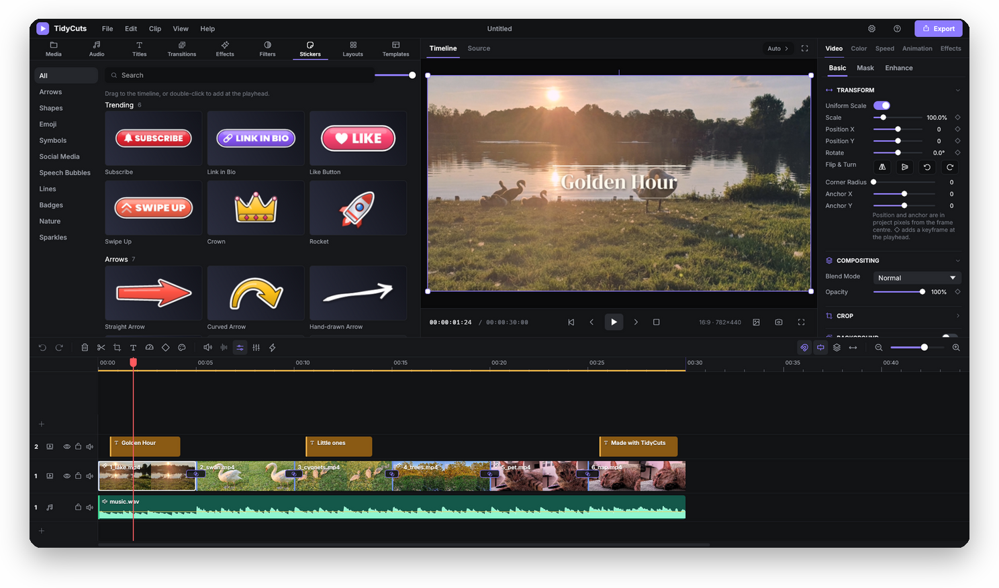
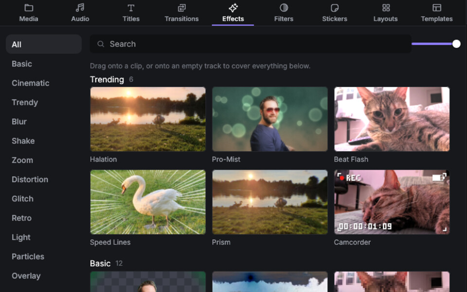
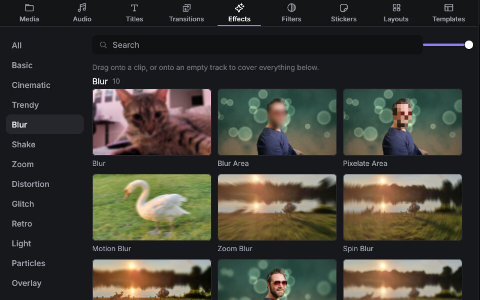
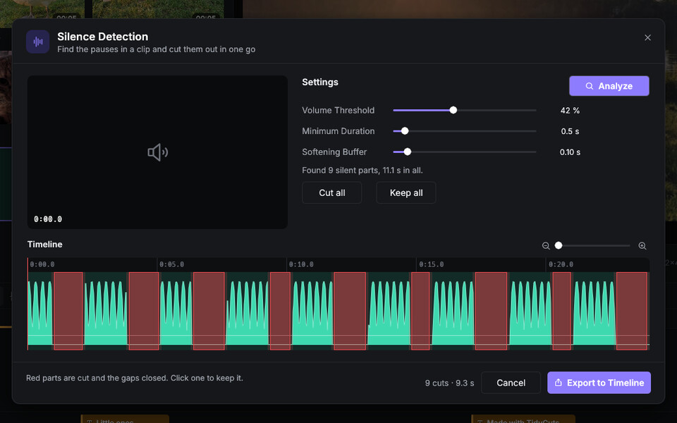
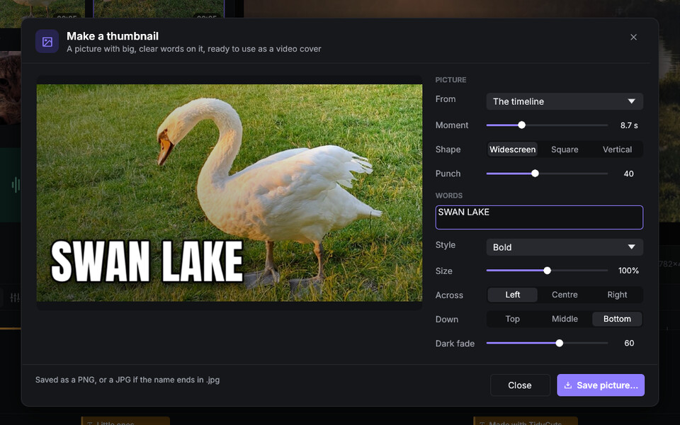

<div align="center">


# TidyCuts

**The free, open-source video editor for Windows and Mac.**<br>
Easy to learn, quick on your graphics card, and everything built in is free to use in your videos.

<br>

<a href="../../releases/download/v1.0.0/TidyCuts-Setup-1.0.0.exe"></a>&nbsp;&nbsp;&nbsp;<a href="../../releases/download/v1.0.0/TidyCuts-1.0.0-macos.dmg"></a>

<sub>Windows 10 and 11 &nbsp;·&nbsp; Mac with Apple silicon (M1 or newer)</sub>

<sub>Version 1.0.0 · Free · No account · <a href="../../releases/latest">All downloads and a portable Windows version</a></sub>

<br>



</div>

<br>

## Why TidyCuts

<table>
  <tr>
    <td valign="top" width="33%">
      <b>Easy to pick up</b><br>
      A familiar layout: library, player and timeline. Cut a clip and the gap closes by itself.
    </td>
    <td valign="top" width="33%">
      <b>Everything included</b><br>
      Titles, effects, filters, transitions, stickers and music, all made by TidyCuts and free to use.
    </td>
    <td valign="top" width="33%">
      <b>Private and fast</b><br>
      Runs on your graphics card. No account, no tracking, and it works offline.
    </td>
  </tr>
</table>

## What you can do

<table>
  <tr>
    <td width="50%"><br><sub><b>105 effects</b>, each tile shown on a real picture</sub></td>
    <td width="50%"><br><sub><b>Blur a face</b> or any area, and follow it</sub></td>
  </tr>
  <tr>
    <td width="50%"><br><sub><b>Silence Detection</b> cuts the pauses out in one go</sub></td>
    <td width="50%"><br><sub><b>Thumbnail maker</b>: big lettering on any frame</sub></td>
  </tr>
</table>

- **68 titles** with animated captions, **96 filters**, **73 transitions**, **117 stickers**, 21 templates and 70 music tracks and sound effects
- **Magnetic timeline** with up to 10 video and 5 audio tracks, speed ramps and keyframes
- **Colour tools:** curves, HSL, colour wheels, your own LUTs and scopes
- **Voiceover** from typed text, a **thumbnail maker**, scene and beat detection
- An optional link that lets an AI assistant edit with you, off until you turn it on

[Full feature list](docs/features.md) · [More screenshots](docs/screenshots.md)

## Downloads

| Platform | File | For |
| --- | --- | --- |
| Windows | [TidyCuts-Setup-1.0.0.exe](../../releases/download/v1.0.0/TidyCuts-Setup-1.0.0.exe) | Installer for Windows 10 and 11 |
| Windows | [TidyCuts-1.0.0-windows-portable.zip](../../releases/download/v1.0.0/TidyCuts-1.0.0-windows-portable.zip) | No install: unzip and run |
| Mac | [TidyCuts-1.0.0-macos.dmg](../../releases/download/v1.0.0/TidyCuts-1.0.0-macos.dmg) | Apple silicon, macOS 11 or later |
| Mac | [TidyCuts-1.0.0-macos.zip](../../releases/download/v1.0.0/TidyCuts-1.0.0-macos.zip) | The same app, if the disk image gives trouble |

FFmpeg is included. Checksums for every file are on the [releases page](../../releases/latest).
Intel Macs are not supported yet.

## How it was made

TidyCuts was written by an AI. **Claude**, made by Anthropic, wrote the code, tests,
built-in content and documentation. The owner of TidySweep Software decided what to
build and tested every version on real Windows and Mac computers.
[Read the whole story, including what wasn't tested](docs/how-this-was-made.md).

## Open source

Released under the [Apache License 2.0](LICENSE): use it, change it and share it.
[Report a bug](../../issues/new/choose) · [Contribute](CONTRIBUTING.md) ·
[Security](SECURITY.md) · [Privacy](PRIVACY.md) · [Build it yourself](docs/building.md)

## Help installing

TidyCuts isn't signed with a paid certificate yet, so Windows and macOS may show a
warning the first time. It's about who published the file, not what's in it, and you
can read all of the code here.

<details>
<summary><b>Mac: "cannot verify that it is free of malware"</b></summary>
<br>

1. Click **Done** (not "Move to Trash").
2. Open the Apple menu → **System Settings** → **Privacy & Security**.
3. Scroll to **Security**, find *"TidyCuts" was blocked to protect your Mac*, and click **Open Anyway**.
4. Enter your Mac password or use Touch ID, then click **Open**.

It opens normally from then on.
</details>

<details>
<summary><b>Mac: "TidyCuts is damaged and can't be opened"</b></summary>
<br>

The app isn't damaged: macOS marks downloaded files and sometimes reacts badly to the mark.
Open **Terminal**, paste this line, press Return, and open TidyCuts again:

```
xattr -cr /Applications/TidyCuts.app
```

If the disk image itself won't open, use the `.zip` instead.
</details>

<details>
<summary><b>Windows: "Windows protected your PC"</b></summary>
<br>

Click **More info**, then **Run anyway**.
</details>

More detail, checksums and where TidyCuts keeps its files: [docs/install.md](docs/install.md).

<br>

<div align="center">
<sub>A <b>TidySweep Software</b> project · <a href="CHANGELOG.md">What's new</a> · <a href="docs/install.md">Install help</a> · <a href="docs/how-this-was-made.md">How it was made</a></sub>
</div>
