# Screenshots

[Back to the project page](../README.md)

All pictures are taken from the real app. The sample pictures on the library tiles
are public-domain (CC0) photographs, credited in [THIRD-PARTY-NOTICES.md](../THIRD-PARTY-NOTICES.md).

## The editor

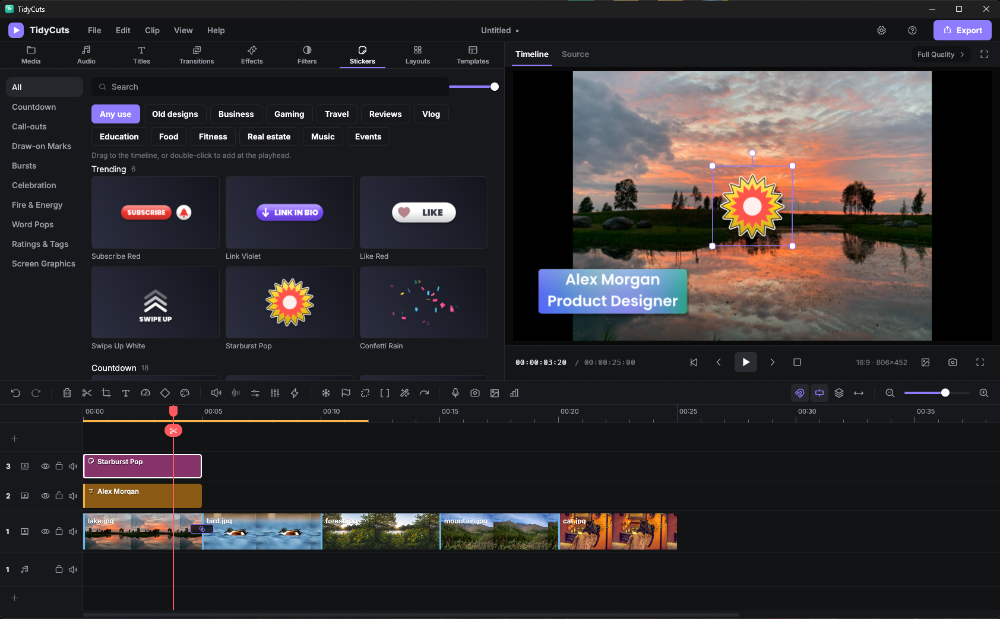

The row of buttons above the timeline puts the handy tools one click away: freeze frame, marker, detach audio, trim, smart cuts, rotate, voiceover, snapshot, thumbnail and scopes. The chips above the tiles (Business, Gaming, Travel and so on) narrow every library to one kind of video, and **Old designs** brings back the earlier looks.

## The library

<table>
  <tr>
    <td width="50%">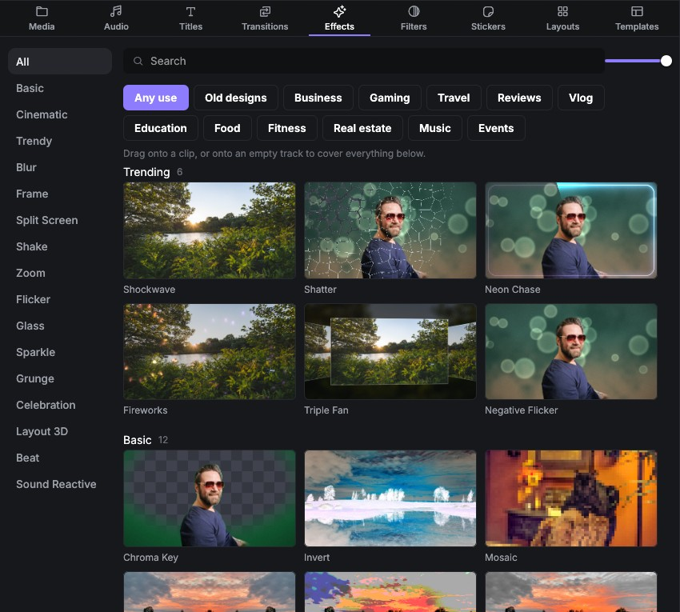 <b>Effects.</b> Glass, beat and a new Sound Reactive group that follows the clip's own sound.</td>
    <td width="50%">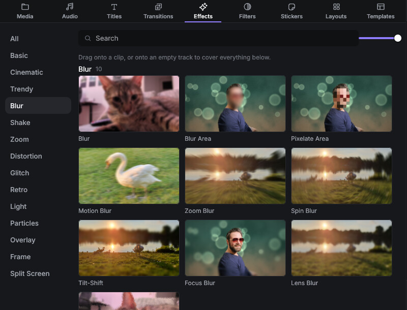 <b>Blur a face.</b> Blur Area and Pixelate Area hide anything you choose.</td>
  </tr>
  <tr>
    <td width="50%">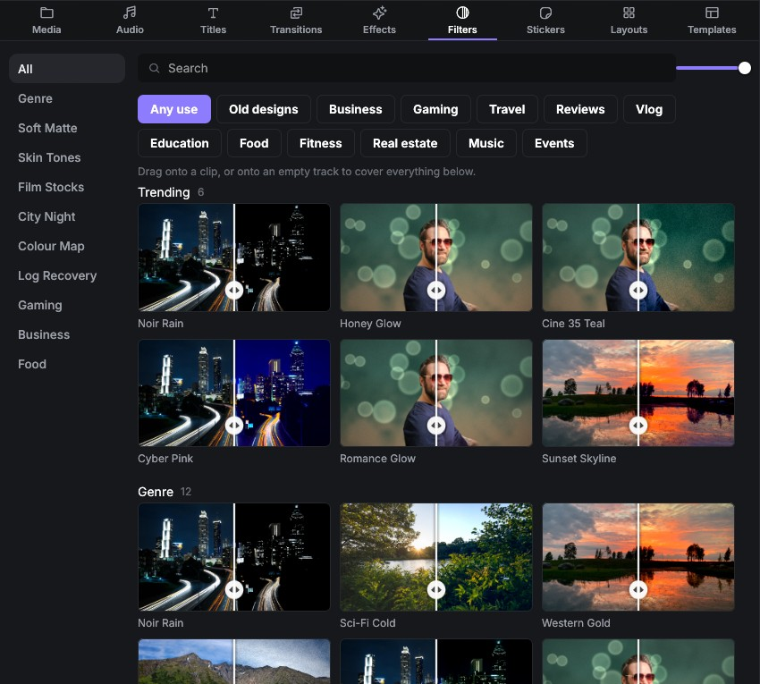 <b>96 filters</b> in styles like Genre, Skin Tones, Film Stocks, City Night and Gaming.</td>
    <td width="50%">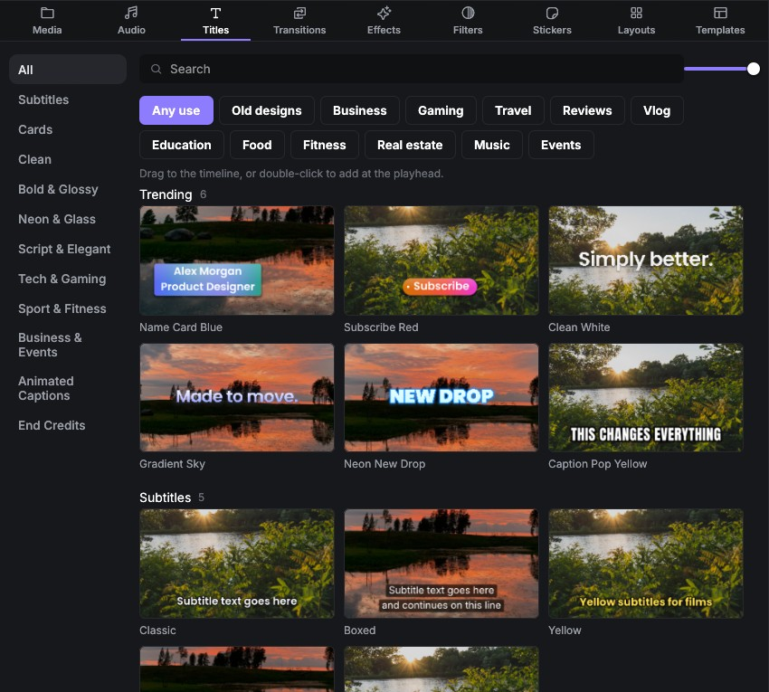 <b>Titles and animated captions</b> in a modern style, 160 in all.</td>
  </tr>
  <tr>
    <td width="50%">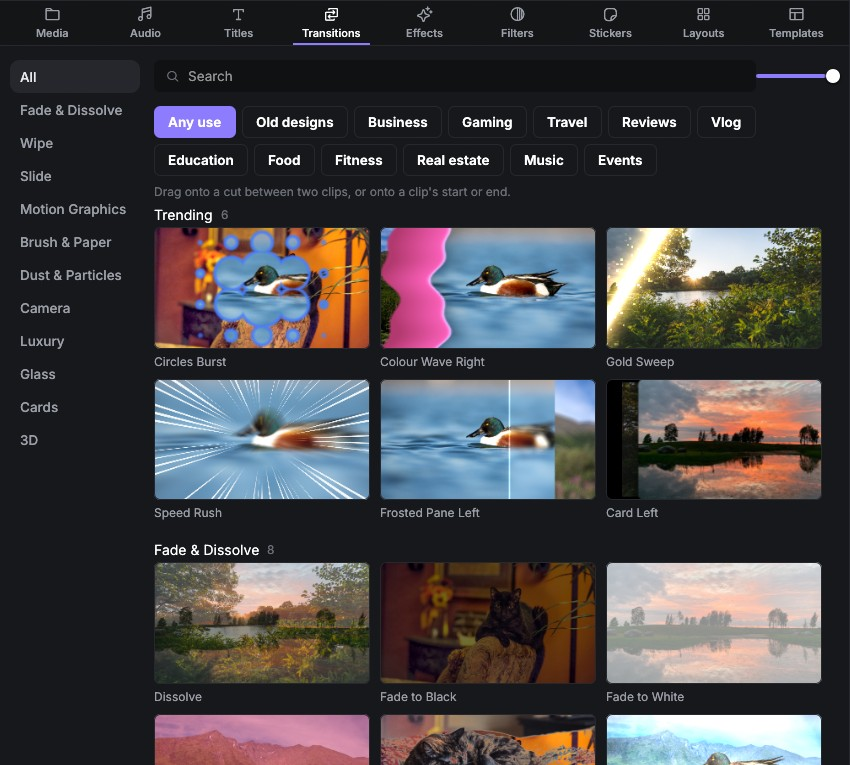 <b>130 transitions</b>, from dissolves to glass slabs, torus rings and cracking ice.</td>
    <td width="50%">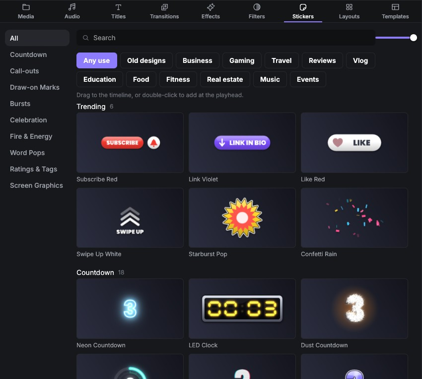 <b>224 stickers</b>, drawn in code: call-outs, word pops, fire and fireworks.</td>
  </tr>
  <tr>
    <td width="50%">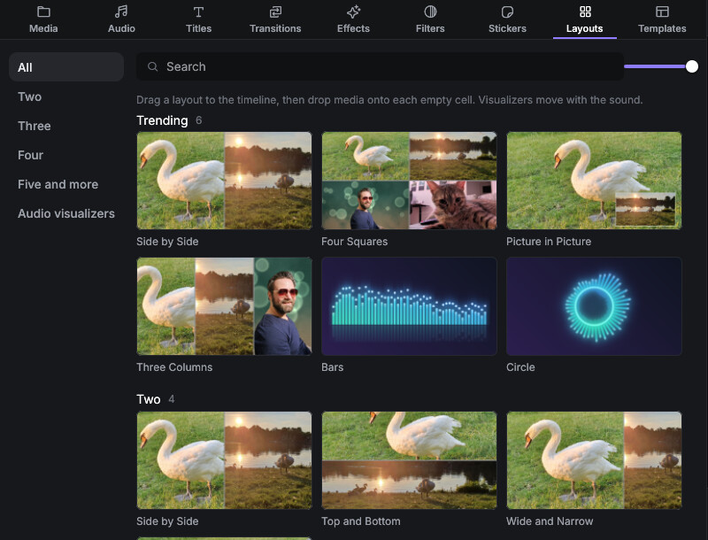 <b>Split screens and audio visualizers.</b></td>
    <td width="50%">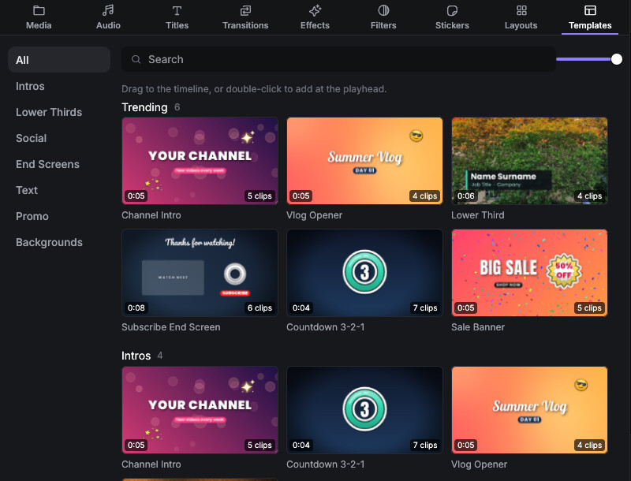 <b>Templates</b> for intros, lower thirds and end screens.</td>
  </tr>
</table>

## Tools

<table>
  <tr>
    <td width="50%">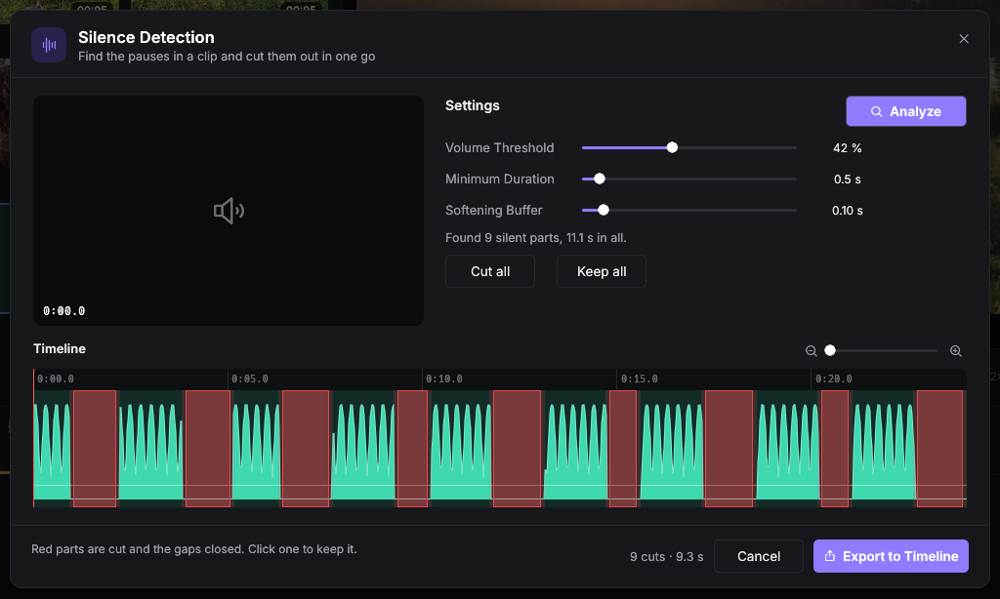 <b>Silence Detection.</b> Red parts are cut, and the gaps close.</td>
    <td width="50%">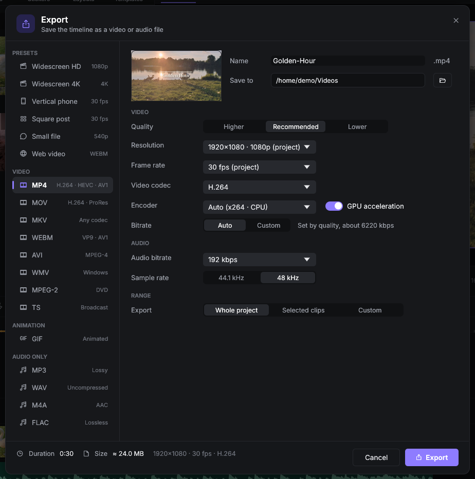 <b>Export.</b> Presets, formats, quality and GPU acceleration.</td>
  </tr>
  <tr>
    <td width="50%">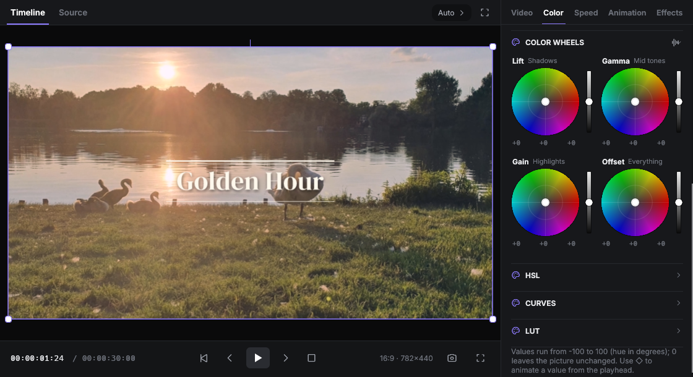 <b>Colour wheels</b> for lift, gamma, gain and offset.</td>
    <td width="50%">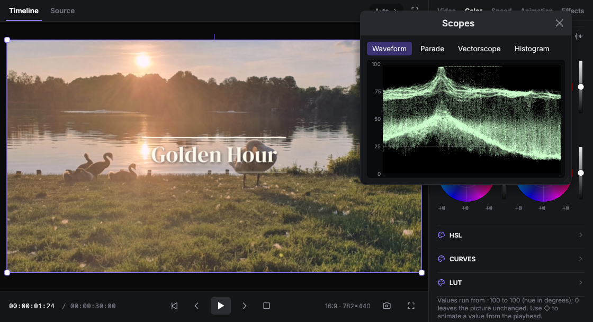 <b>Scopes:</b> waveform, parade, vectorscope and histogram.</td>
  </tr>
  <tr>
    <td width="50%">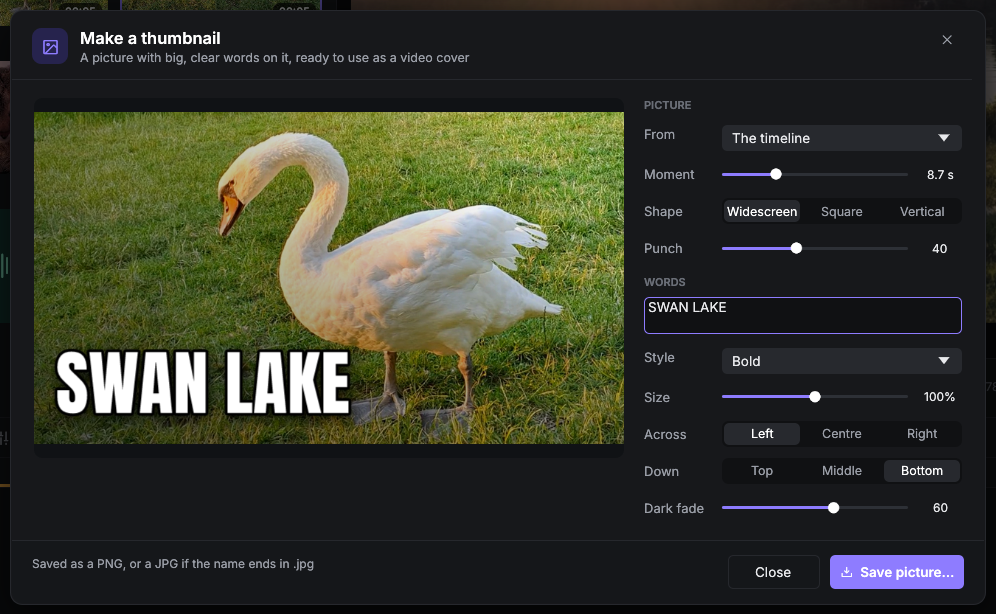 <b>Thumbnail maker.</b> Big lettering on any frame.</td>
    <td width="50%">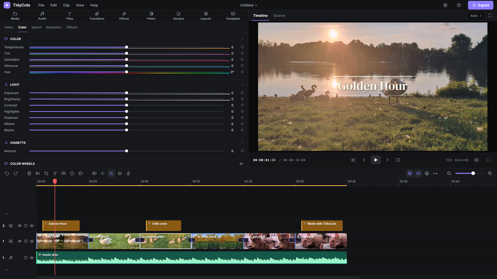 <b>Layouts.</b> Standard, Mirrored, or Left menus (shown).</td>
  </tr>
</table>
